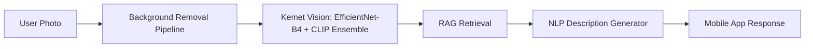

# Background Removal Pipeline — Model V5

**Ensemble Segmentation: BiRefNet + rembg (IS-Net)**
**Target:** Egyptian Monuments & Landmarks (Foreground Only — People Excluded)

A robust, production-ready background removal system specifically engineered for Egyptian archaeological artifacts and large architectural structures.

---

## 🎯 Objective

This pipeline serves as the **first stage** in the full Egyptian Artifact Recognition system. It removes complex backgrounds from user-captured images while preserving fine details of monuments, statues, temples, and artifacts.

The cleaned foreground images are then passed to the classification model (EfficientNet-B4 ensemble) and subsequently to the NLP description generator.

> **Upcoming Integration:** This module will be integrated into the mobile application. The user will upload a photo → it will automatically go through background removal → classification → contextual description.

---

## 🧭 Role in Kemet Vision: Why Classification Accuracy Is Critical

This model was built specifically to support **[Kemet Vision](https://github.com/AhmedNasser5/Kemet-Vision)** — the image classification model at the core of the Egyptian Cultural Heritage Recognition system — and to help it reach the highest possible classification accuracy.

### The Problem

In Kemet Vision, the predicted class label is not the final output. It is used as the **query key for a Retrieval-Augmented Generation (RAG) pipeline**, which retrieves the historical and archaeological information shown to the user:

```
Image → Classification → Predicted Label → RAG Retrieval → Generated Description
```

This makes the label a **single point of failure**. A misclassification does not simply produce a wrong class name — it causes the RAG system to retrieve the knowledge of a *different* monument and present it to the user as fact. The result is a confident, well-written, but **factually incorrect** answer. In a cultural-heritage and educational context, this is far worse than returning no answer at all.

For this reason, the classification stage must operate with near-perfect reliability, and anything that degrades it must be eliminated upstream.

### Why Background Removal Matters

Real-world photos of Egyptian monuments are visually noisy. Common sources of classification error include:

- **Tourists and crowds** that dominate the frame or distract the classifier
- **Cluttered surroundings**, such as other monuments, vendors, vehicles, and signage
- **Museum conditions**, including glass reflections, display cases, and uneven lighting
- **Visually similar sites and artifacts** (e.g., similar temple facades, statues of the same dynasty), where background context can bias the prediction toward the wrong class
- **Spurious correlations**, where the model learns the *scene* (desert sky, museum hall) instead of the *monument itself*

By isolating the monument from its surroundings, this pipeline ensures that Kemet Vision classifies **only the subject** and not the context around it.

### How This Pipeline Supports Kemet Vision

| Objective | How It Is Achieved |
|---|---|
| **Remove distracting context** | Ensemble segmentation (BiRefNet + rembg) isolates the monument from complex backgrounds |
| **Exclude non-subject objects** | The Large Structure Selector discards tourists and small objects, keeping only the main monument |
| **Preserve discriminative details** | Guided Filter and edge-preserving post-processing retain carvings, hieroglyphs, and statue features that distinguish similar classes |
| **Avoid bad inputs** | The Empty Mask Guard rejects images with insufficient foreground instead of passing noise to the classifier |
| **Consistent input distribution** | Clean, uniform foreground-only images reduce variance between training data and real user uploads |
| **Protect the RAG layer** | More accurate labels mean the correct monument name reaches the RAG, and therefore correct information reaches the user |

### Design Principle

> **Correct label → correct retrieval → correct information.**
> The background removal stage exists to guarantee the first link in this chain, because every downstream component depends on it.

---

## 🏗️ Pipeline Architecture

| Component                  | Model                     | Purpose                              |
|---------------------------|---------------------------|--------------------------------------|
| Primary Segmentation      | **BiRefNet** (ZhengPeng7) | Fine edges and complex boundaries    |
| Secondary Segmentation    | **rembg / IS-Net**        | Reliable general-purpose baseline    |
| Post-Processing           | Guided Filter + Morphology| Edge-preserving refinement           |
| Subject Selection         | LargeStructureSelector    | Keep largest monument structure only |

---

## 🔧 Key Features & Optimizations

- **VRAM Optimized (v5.1)**: SAM2 completely removed. BiRefNet forced to CPU to prevent CUDA OOM.
- **Large Structure Selector**: Removes tourists and small objects while keeping major monuments.
- **Ensemble Weighted Merge**: BiRefNet (60%) + rembg (40%).
- **Empty Mask Guard**: Skips images with insufficient foreground.
- **Checkpoint System**: Supports resuming after kernel crashes.
- **Comprehensive Logging & Reporting**: JSON report with full statistics.

---

## ⚙️ Configuration Highlights

- **BiRefNet Device**: CPU (forced for stability)
- **rembg Device**: CUDA when available
- **Input Resolution**: Original + internal 1024×1024 processing
- **Minimum Subject Ratio**: 5% of image area
- **Post-Processing**: Morphological operations + Guided Filter + Bilateral Filter

---

## 📁 Output Structure

```
Model 1/
├── results/              # Final transparent PNGs (_nobg.png)
├── masks/                # Grayscale alpha masks
├── comparisons/          # 3-panel visual comparison (Original | Mask | Result)
├── processing_report.json
└── checkpoint.json       # Resume support
```

---

## 🛠️ Tech Stack

- **Deep Learning**: PyTorch, Hugging Face Transformers, timm
- **Segmentation**: BiRefNet, rembg (IS-Net)
- **Image Processing**: OpenCV, Pillow, scikit-image, SciPy
- **Environment**: Anaconda + JupyterLab

---

## 📊 Performance Characteristics

- Designed specifically for **Egyptian museum and outdoor monument** photography
- Handles glass reflections, varying lighting, and complex backgrounds
- Preserves intricate details (carvings, hieroglyphs, statue features)
- Optimized for batch processing of large datasets

---

## 🔄 Integration Flow (Planned)



---

## 🔗 Related Projects

- **[Kemet Vision](https://github.com/AhmedNasser5/Kemet-Vision)** — Egyptian monument and artifact classification model that consumes the output of this pipeline.

---

This background removal model is a critical component of the full-stack AI system for Egyptian Cultural Heritage Recognition. Its purpose is not only visual cleanup, but to ensure that Kemet Vision receives the cleanest possible input, so that the label passed to the RAG is correct and the information delivered to the user is accurate.
